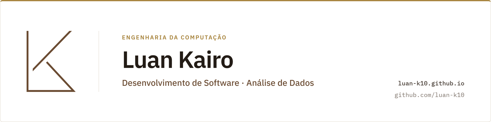

<picture>
  <source media="(prefers-color-scheme: dark)" srcset="assets/banner-dark.png">
  
</picture>

  
  
  

## Sobre

Me chamo **Luan Kairo de Souza das Neves**, tenho <!--idade-->23<!--/idade--> anos e sou natural do **Espírito Santo**.

- Graduando em **Engenharia da Computação** na Multivix, com conclusão prevista para dezembro de 2027.
- Estagiário em sistemas de automação de **Nível 2** na **ArcelorMittal Tubarão**, onde investigo falhas, corrijo bugs em **Java** e escrevo consultas **SQL Oracle** para relatórios e indicadores.
- Experiência com **Databricks** e conhecimentos em **Power BI**.
- Gosto de unir desenvolvimento de software e dados para resolver problemas reais de processo.

Projetos, experiência e currículo completos no meu [portfólio](https://luan-k10.github.io).

## Tecnologias

  
  
  
  
  
  

  
  
  
  
  

  
  
  
  
  
  

## Projetos em destaque

| Projeto | Descrição | Tecnologias |
| --- | --- | --- |
| [**aplicativo-analise-de-risco**](https://github.com/luan-k10/aplicativo-analise-de-risco) | Software de análise de risco digital com gestão de equipes, autorização de entrada e saída e escolha de riscos, seguindo as NRs. Projeto de Extensão (PEI), com **Menção Honrosa** na IV Mostra de PEI (2025/1). | Angular, TypeScript, SSR |
| [**valeime-site**](https://github.com/luan-k10/valeime-site) · [site](https://valeime.netlify.app) | Site de sugestões do perfil católico [@valeime.catolico](https://instagram.com/valeime.catolico). As respostas vão para uma planilha do Google Sheets. | HTML, JavaScript, Apps Script |
| [**estudos**](https://github.com/luan-k10/estudos) · [site](https://luan-k10.github.io/estudos/) | Guia de estudos da faculdade: central por áreas que reúne sites interativos de cada matéria ([Programação Distribuída e Paralela](https://github.com/luan-k10/estudo-programacao-distribuida) e [Avaliação e Desempenho de Sistemas](https://github.com/luan-k10/estudo-avaliacao-desempenho)), com resumos, quiz, simulado, flashcards e laboratório. O progresso fica salvo no navegador. | HTML, CSS, JavaScript |
| [**luan-k10.github.io**](https://github.com/luan-k10/luan-k10.github.io) · [site](https://luan-k10.github.io) | Portfólio pessoal com projetos, carreira, certificados e currículo, publicado no GitHub Pages. | Astro, TypeScript, CSS |

## Prêmios e certificados

| Título | Instituição | Detalhe |
| --- | --- | --- |
| **Menção Honrosa**, IV Mostra de Práticas de Extensão Interdisciplinar | Multivix Serra | 2025/1 |
| [Programação em Microsoft C# do básico ao avançado](https://ude.my/UC-8315b01f-1154-4c67-a305-4f94e823768d) | Udemy | 20h |
| [Curso Completo de Banco de Dados e SQL para Iniciantes](https://ude.my/UC-6fefdb99-f640-4022-aac7-8bf9e1266286) | Udemy | 5h |
| [Algoritmos e Lógica de Programação do básico ao avançado](https://ude.my/UC-749dc3c9-781f-4d4c-a777-b195f740fb63) | Udemy | 33,5h |

## Atividade no GitHub

<picture>
  <source media="(prefers-color-scheme: dark)" srcset="https://streak-stats.demolab.com?user=luan-k10&background=1D1611&border=2F251D&stroke=2F251D&ring=C49B4E&fire=C49B4E&currStreakNum=F2ECE3&sideNums=F2ECE3&currStreakLabel=C9A874&sideLabels=C9A874&dates=978A79&locale=pt_BR&disable_animations=true">
  
</picture>

<picture>
  <source media="(prefers-color-scheme: dark)" srcset="https://github-readme-activity-graph.vercel.app/graph?username=luan-k10&bg_color=1D1611&color=C9A874&title_color=F2ECE3&line=C49B4E&point=F2ECE3&area=true&area_color=6B4C33&hide_border=true&custom_title=Contribui%C3%A7%C3%B5es">
  
</picture>

---

Luan Kairo · Engenharia da Computação · <a href="https://luan-k10.github.io">luan-k10.github.io</a>